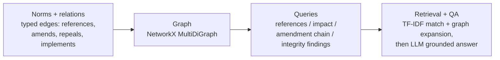

# NormaGraph

A knowledge graph of regulations. It models norms (articles, decrees, laws) and
the typed relationships between them — references, amendments, repeals,
implementations — and turns that structure into answers: what a norm depends on,
what depends on it, what would break if it changed, and where the corpus is
inconsistent. On top sits a retrieval layer that uses the graph, and an LLM
question-answering layer grounded in the retrieved norms.

[](.github/workflows/ci.yml)
[](pyproject.toml)
[](LICENSE)

---

## Why it matters

Regulation is a web, not a list. An article means nothing without the definitions
it relies on, the regulation that implements it, and the amendments that have
changed it. Government and legal teams need to answer questions a flat document
store cannot: *if we change this definition, which articles are affected? Does
anything still in force point to a repealed rule? Which norms govern this topic,
and what do they connect to?*

NormaGraph answers these because it treats the corpus as a graph:

- **Impact analysis.** For any norm, find everything that transitively depends on
  it — the blast radius of a change.
- **Integrity checks.** Surface dangling references, in-force norms that depend on
  repealed ones, amendment cycles, repealed-but-still-in-force norms, and orphans.
- **Structure-aware retrieval.** Find norms by text, then expand along the graph to
  the norms they connect to — because the neighbours are often the point.
- **Grounded answers.** An LLM answers questions using only the retrieved norms and
  cites them, with an offline fallback.

## How it works



1. **Graph (`graph.py`).** Norms are nodes; typed relationships are directed
   edges. Queries read naturally off the graph: `references_of`, `referenced_by`,
   `amendment_chain`, and `impact_of` (reverse-reachability over dependency edges).
2. **Integrity (`analysis.py`).** A set of checks walks the graph and reports
   defects a maintainer should fix.
3. **Retrieval (`retrieval.py`).** TF-IDF finds text matches; the graph adds their
   neighbours so the answer includes the norms around a match.
4. **QA (`qa.py`).** The LLM answers using only the retrieved norms and cites
   them; if it is unreachable, the top matching norm's text is returned.

## Impact analysis and integrity, precisely

**Impact = reverse reachability over dependency edges.** "What breaks if this norm
changes?" is answered by a breadth-first walk that follows `references` and
`implements` edges **backwards** from the target: start at the norm, step to the
norms that reference or implement it, then repeat, transitively, with an optional
hop limit. `amends` and `repeals` are deliberately excluded — they describe what a
norm *does to* another, not a standing dependency *on* it. The walk is `O(V + E)`
over the reached sub-graph. In the bundled corpus, changing `ART-2` (Definitions)
reaches seven downstream norms, directly and transitively.

**Integrity checks are graph queries.** Each consistency rule is a single pass
that emits typed findings:

| Finding                    | Rule                                                        |
| -------------------------- | ----------------------------------------------------------- |
| `dangling_reference`       | an edge whose target norm does not exist                    |
| `depends_on_repealed`      | an in-force norm referencing/implementing a repealed norm   |
| `repealed_still_in_force`  | a norm a `repeals` edge points at, still marked in force    |
| `amendment_cycle`          | a cycle in the `amends` sub-graph (NetworkX `simple_cycles`)|
| `orphan`                   | a norm with degree zero                                     |

These are structural truths found by traversal, not by reading prose; the bundled
corpus embeds three of them on purpose so the check has something to find. They
catch inconsistencies in the recorded graph, not errors of legal substance — a
necessary foundation kept deliberately objective and false-positive-free.

## Quick start

```bash
python -m venv .venv && source .venv/bin/activate
pip install -e ".[dev]"

# Build the graph and run searches, impact analysis, and integrity checks:
python -m normagraph.cli demo

# Run the HTTP API:
uvicorn normagraph.main:app --reload
```

Example API calls:

```bash
curl -s 'localhost:8000/search?q=international%20transfers'
curl -s localhost:8000/norms/ART-2        # detail: references, impact, status
curl -s localhost:8000/integrity          # corpus defects
curl -s -X POST localhost:8000/ask -H 'content-type: application/json' \
  -d '{"question": "how long do I have to report a breach?"}'
```

## Configuration

Settings load from environment variables with the `NG_` prefix (see
`.env.example`):

| Variable            | Default                                   | Meaning                             |
| ------------------- | ----------------------------------------- | ----------------------------------- |
| `NG_TOP_K`          | `3`                                       | Text matches to return              |
| `NG_EXPAND_HOPS`    | `1`                                       | Graph hops to expand around matches |
| `NG_LLM_SPEC`       | `anthropic,openai,gemini,deepseek,ollama` | Provider cascade for the QA layer   |
| `NG_LLM_MAX_TOKENS` | `400`                                     | Max tokens per LLM call             |

With no API keys, retrieval and the graph work fully; the QA layer returns the
top matching norm instead of an LLM-written answer.

## Testing

```bash
ruff check normagraph tests
pytest --cov=normagraph --cov-report=term-missing --cov-fail-under=80
```

The suite covers the graph queries (references, impact, amendment chain,
neighbours), the integrity checks (including crafted cases for cycles and
repealed-still-in-force), graph-expanded retrieval, the QA layer (LLM and
fallback), the HTTP API, and the CLI. Nothing in the tests touches a real network.

## Documentation

- `docs/architecture.md` — the full picture and the data flow.
- `docs/adr/` — the main design decisions and why they were made.
- `docs/estudio/` — a study guide in Spanish, for learning the project in depth.

## License

MIT. See [LICENSE](LICENSE).
