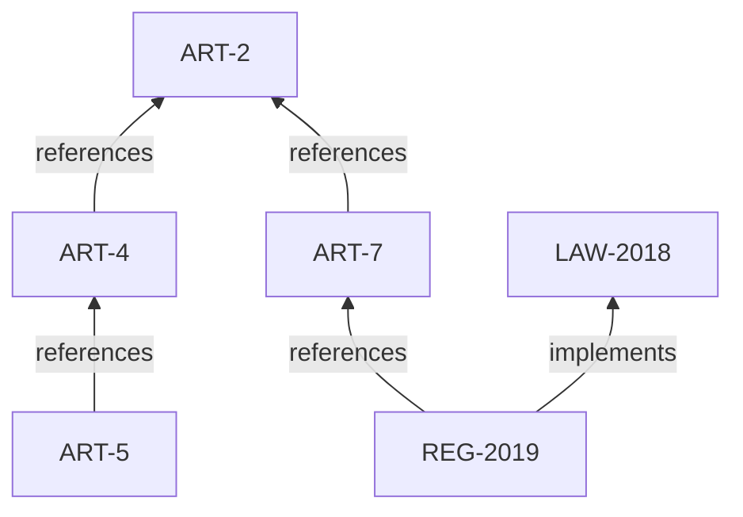

# Architecture

NormaGraph models a regulatory corpus as a graph and answers questions off that
structure. This document describes the pieces, the data flow, and the boundaries
between them.

## The pieces

| Layer          | Module                    | Responsibility                                            |
| -------------- | ------------------------- | --------------------------------------------------------- |
| Domain         | `normagraph/norms.py`     | Norms, statuses, and relationship types                   |
| Corpus         | `normagraph/data.py`      | A synthetic corpus with deliberate defects                |
| Graph          | `normagraph/graph.py`     | NetworkX graph + queries (references, impact, chain)      |
| Integrity      | `normagraph/analysis.py`  | Checks for defects in the corpus                          |
| Retrieval      | `normagraph/retrieval.py` | TF-IDF match + graph expansion                            |
| QA             | `normagraph/qa.py`        | LLM answer grounded in retrieved norms (+ fallback)       |
| LLM interface  | `normagraph/llm/`         | Provider-agnostic client with a fallback cascade          |
| Orchestration  | `normagraph/service.py`   | Build everything and expose the operations                |
| HTTP API       | `normagraph/main.py`      | Search, norm detail, integrity, and ask over REST         |
| CLI            | `normagraph/cli.py`       | End-to-end demo                                           |

## The model: norms and typed edges

A **norm** is an atomic piece of regulation (an article, a decree, a law) with a
status (`in_force`, `repealed`, `draft`). A **relation** is a typed directed edge
`source --type--> target`, where the type is one of `references`, `amends`,
`repeals`, or `implements`. Representing the corpus this way is the whole idea:
the interesting questions are about the edges, not the text.

## Why a graph, and which queries

- **`references_of` / `referenced_by`** are the out- and in-edges of type
  `references`: what a norm cites, and what cites it.
- **`amendment_chain`** follows `amends` edges forward: the lineage of a norm's
  modifications.
- **`impact_of`** is the key query. It walks dependency edges (`references`,
  `implements`) **backwards** from a norm: everything that transitively depends on
  it, i.e. the blast radius if it changes. This is reverse reachability, done with
  a breadth-first walk and an optional hop limit.

A `MultiDiGraph` is used because two norms can be connected by more than one kind
of relationship.

## Integrity checks

`analyze` walks the graph and reports:

- **dangling_reference** — an edge whose target norm does not exist;
- **depends_on_repealed** — an in-force norm that references or implements a
  repealed norm;
- **repealed_still_in_force** — a norm repealed by another but still marked in
  force;
- **amendment_cycle** — a cycle in the `amends` subgraph;
- **orphan** — a norm with no relationships at all.

These are structural truths about the corpus, found by graph traversal, not by
reading prose. The bundled corpus embeds three of them on purpose so the check
has something to find.

## Structure-aware retrieval

`NormRetriever` fits TF-IDF over each norm's title and text and returns the top-k
text matches. Then it **expands** along the graph: for each match it adds the
norm's neighbours (bounded by a hop count). Regulation is cross-referential, so
the norms around a match — the definitions it relies on, the article that amends
it — are frequently what the reader actually needs. Each result is tagged `match`
or `graph` so the origin is clear.

## The QA layer

`RegulationQA` retrieves the relevant norms (with graph expansion), builds a
context block from their text, and asks the LLM to answer using only that context
and to cite the norm ids. The LLM is the provider-agnostic `LLMClient` with a
fallback cascade. If the LLM is unreachable, the top matching norm's text is
returned with its id as the citation — an answer that is always grounded and
traceable.

## Extension points

- **Corpus.** `data.py` is a stand-in; a real loader would ingest legislation and
  extract its cross-references into the same `Norm` / `Relation` shape.
- **Relationship types.** New edge types (e.g. "derogates", "consolidates") add to
  the enum and the queries that use them.
- **Integrity checks.** Each check is a small, independent pass over the graph;
  new ones drop into `analyze`.
- **Retrieval.** The TF-IDF retriever can be swapped for a dense retriever behind
  the same interface; the graph expansion stays unchanged.
