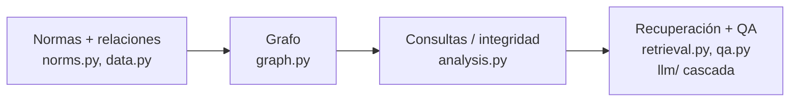

# 04 — Arquitectura y decisiones de diseño

## Las piezas, de principio a fin

Por encima: la **API HTTP** (`main.py`, FastAPI) y la **CLI** (`cli.py`, demo).

## Flujo

1. `NormGraph(norms, relations)` construye el grafo con NetworkX.
2. Consultas de grafo: `references_of`, `referenced_by`, `amendment_chain`,
   `impact_of`.
3. `analyze(graph)` recorre el grafo y devuelve hallazgos de integridad.
4. `NormRetriever` recupera por texto y expande por el grafo.
5. `RegulationQA` responde con el LLM fundamentado en lo recuperado (o fallback).

## Decisión 1: el corpus es un grafo dirigido con tipos

Explicada en la guía 01. Nodos = normas (con estado), aristas = relaciones tipadas
(`references`, `amends`, `repeals`, `implements`). Las preguntas importantes son
consultas de grafo. `MultiDiGraph` para permitir varias relaciones entre dos
normas.

## Decisión 2: impacto = alcanzabilidad inversa por aristas de dependencia

Explicada en la guía 02. Definición precisa de "afectado": lo que depende
transitivamente de una norma vía `references`/`implements`, recorrido hacia atrás,
con límite de saltos opcional. amends/repeals no cuentan como dependencia.

## Decisión 3: recuperación que expande por el grafo

Explicada en la guía 03. TF-IDF para las coincidencias + vecinos del grafo, porque
en regulación el contexto alrededor de una coincidencia suele ser el punto. Cada
resultado etiquetado `match` o `graph`.

## Decisión 4: integridad como consultas de grafo

Explicada en la guía 02. Cada regla de consistencia es un recorrido del grafo que
produce hallazgos tipados (dangling, depends_on_repealed, repealed_still_in_force,
amendment_cycle, orphan). Estructurales, objetivas, sin falsos positivos.

## El LLM agnóstico del proveedor

Como en otros proyectos: una interfaz `LLMClient` y una `CascadeLLM` que prueba
varios proveedores en orden y cae al siguiente si uno falla. La QA lo usa; sin
claves, devuelve la mejor norma recuperada. Claves solo del entorno.

## Configuración por entorno

`config.py` con prefijo `NG_`: `NG_TOP_K`, `NG_EXPAND_HOPS`, `NG_LLM_SPEC`,
`NG_LLM_MAX_TOKENS`. Nada sensible en el código.

## Puntos de extensión

- **Corpus:** `data.py` es un sustituto; un cargador real ingeriría legislación y
  extraería sus referencias cruzadas a la misma forma `Norm`/`Relation`.
- **Tipos de relación:** añadir nuevos (p. ej. "consolida") al enum y a las
  consultas.
- **Comprobaciones de integridad:** cada una es un paso independiente sobre el
  grafo; las nuevas se añaden a `analyze`.
- **Recuperación:** cambiar TF-IDF por un recuperador denso tras la misma
  interfaz; la expansión por el grafo no cambia.

## Para fijar la idea

- Capas claras: grafo → consultas/integridad → recuperación/QA.
- Cuatro decisiones: grafo tipado, impacto como alcanzabilidad inversa,
  recuperación expandida por el grafo, integridad como consultas.
- Todo configurable por entorno; el núcleo (grafo, integridad, recuperación)
  funciona sin red.
